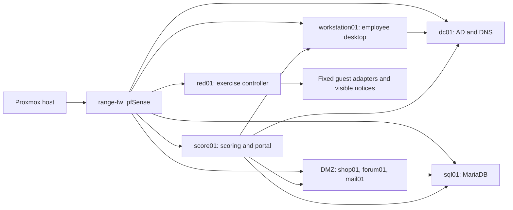

# Architecture and scoring

| Segment | Subnet | Roles |
| --- | --- | --- |
| Management | `10.77.10.0/24` | Organizer management |
| Business | `10.77.20.0/24` | AlmaLinux workstation `.10` |
| DMZ | `10.77.30.0/24` | Ubuntu/PHP shop `.10`, Windows/phpBB forum `.20`, Windows/MailEnable mail `.30` |
| Identity | `10.77.40.0/24` | Windows AD/DNS dc01 `.10` |
| Database | `10.77.50.0/24` | Linux Mint/MariaDB sql01 `.20` |
| Scoring and exercise control | `10.77.70.0/24` | score01 `.10`, red01 `.20` |

Each lab segment uses its `.1` firewall gateway. `corp.summit.test` is a fictional domain. The firewall, scorer, controller and hypervisor are organizer infrastructure outside contestant administration.

Three scoring layers have different purposes. Guest-local Aeacus checks measure host policy and forensics. Central service scoring measures working business services and applies availability/SLA accounting. Timed injects measure task completion and, for selected tasks, subsequent availability. The central portal does not silently merge Aeacus host scores into its total.

The storefront probe exercises purchase and token-based order history, rather than accepting a successful home page alone. The simulated red team uses fixed guest actions, explicit event authorization, visible notices, durable state and scoped recovery. Runtime policy and guest enforcement constrain it to the lab; a full four-hour run is separate acceptance work.
