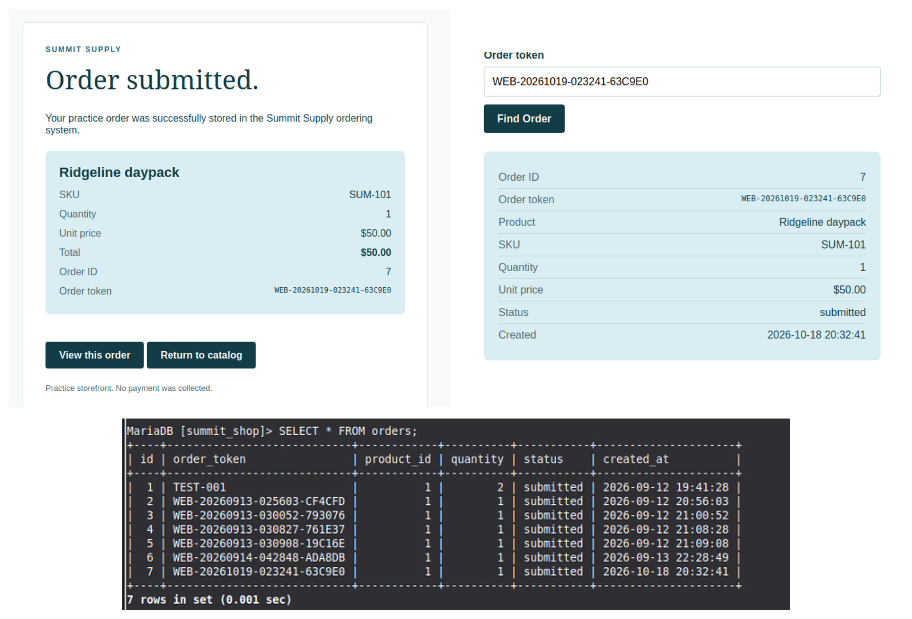
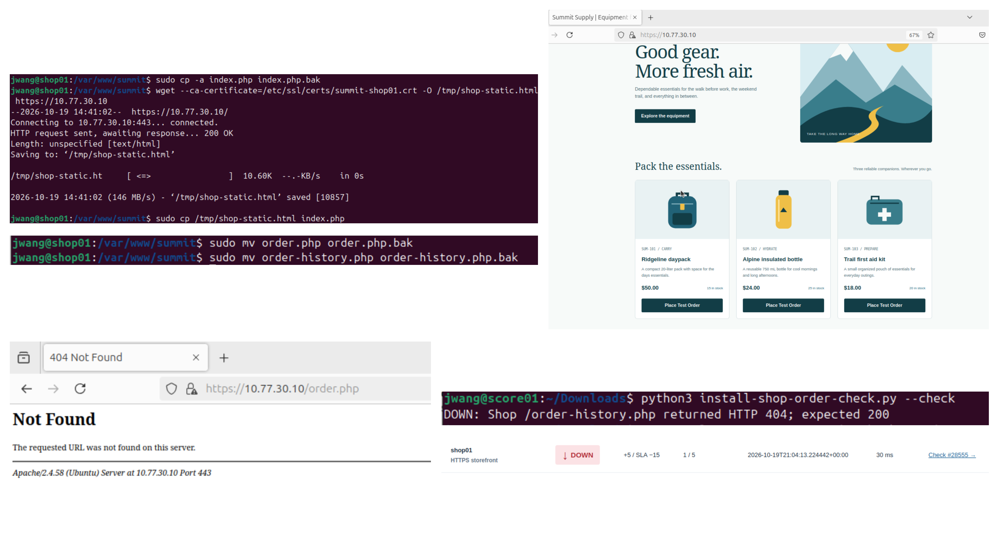

# Demonstration evidence

These stills show observed lab behavior. They are not a continuous recording or a live public service.

## A purchase persisted through the application

The order confirmation and history lookup show the same order token, product and quantity. The database view corroborates persistence.

## A static storefront failed the functional check

The storefront can still look healthy while ordering is broken. The purchase check reports the missing history route, and availability scoring records DOWN.

For the portfolio demonstration, record a short continuous walkthrough that shows the architecture, a working purchase, one controlled failure, its scoring effect, and recovery. Keep credentials and unrelated people/windows out of the recording. Add the reviewed recording link here before submission; no video link is claimed yet.
